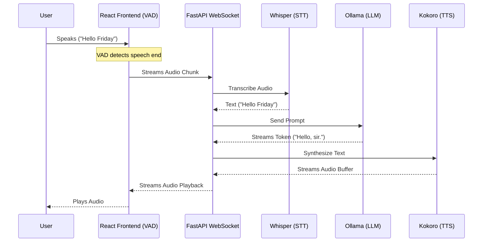

# FRIDAY AI OS — Backend 🧠

The backend system for **FRIDAY (Personal AI Assistant)**. Built for ultra-low latency, real-time voice conversations using an entirely localized, open-source AI stack to guarantee maximum privacy and speed.

## 🚀 Tech Stack

* **Framework:** FastAPI (Python)
* **Real-time Comms:** WebSockets (Full Duplex)
* **Database:** SQLite (via async SQLAlchemy)
* **LLM Engine:** Ollama (Local - `qwen3:8b` / `llama3`)
* **Speech-to-Text (STT):** Whisper (`faster-whisper`)
* **Text-to-Speech (TTS):** Kokoro TTS (Local, High-fidelity)

---

## 🏗️ Architecture

FRIDAY operates on a real-time, event-driven WebSocket architecture to eliminate the "Walkie-Talkie" latency of standard REST APIs.



### Key Workflow
1. **Frontend VAD (Voice Activity Detection):** Prevents dead silence from being transmitted. Only human speech triggers an audio stream.
2. **WebSocket Manager:** Keeps a persistent connection open between the React frontend and the FastAPI backend.
3. **Voice Manager Pipeline:** Coordinates the hand-off between `Whisper` -> `Ollama` -> `Kokoro TTS` seamlessly.

---

## 📂 Directory Structure

```text
backend/
├── app/
│   ├── agents/      # LLM logic, LangGraph/LangChain execution
│   ├── api/         # REST API and WebSocket routers
│   ├── core/        # Config (.env), Logging, Startup Events
│   ├── database/    # SQLite/SQLAlchemy setup & models
│   ├── managers/    # Voice & Chat orchestrators
│   ├── memory/      # Conversation history & Vector embeddings
│   ├── services/    # Wrappers for Whisper, Ollama, TTS
│   ├── tools/       # Tools FRIDAY can use (Search, System Control)
│   └── websocket/   # Connection tracking & event broadcasting
├── storage/         # Local DB (.db) and audio caches (Ignored by Git)
├── tests/           # Unit & Integration testing
├── .env             # Environment variables
└── main.py          # Uvicorn entry point
```

---

## 💻 Quick Start

**1. Setup Environment**
```bash
python -m venv .venv
source .venv/bin/activate
pip install -r requirements.txt
pip install langchain-ollama  # Required for local models
```

**2. Ensure Local AI is Running**
* Have **Ollama** installed and running on `http://localhost:11434`
* Ensure your model is pulled: `ollama run qwen2.5:8b` (or your preferred model)

**3. Start the Server**
```bash
uvicorn app.main:app --reload --host 0.0.0.0 --port 8000
```

**4. Endpoints**
- REST Docs: http://localhost:8000/docs
- Health Check: http://localhost:8000/api/health/
- WebSocket Endpoint: `ws://localhost:8000/ws/{client_id}`
