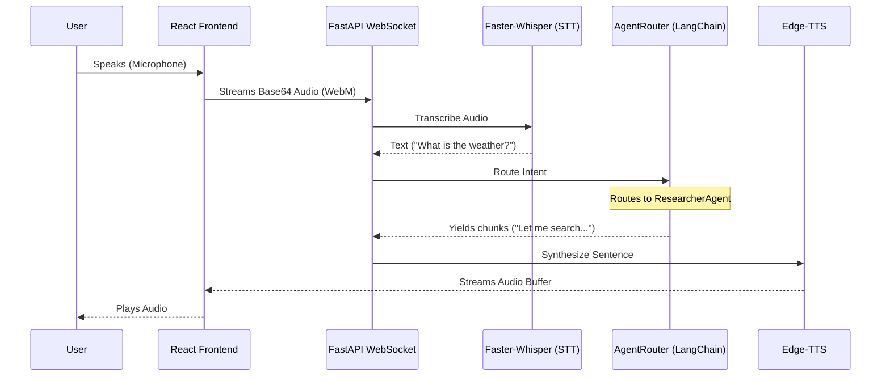

# FRIDAY AI OS — Backend 🧠

The backend system for **FRIDAY (Personal AI Assistant)**. Built for ultra-low latency, real-time voice conversations using an entirely localized, open-source AI stack to guarantee maximum privacy and speed.

## 🚀 Tech Stack

* **Framework:** FastAPI (Python)
* **Real-time Comms:** WebSockets (Full Duplex)
* **Agent Routing:** LangChain (Agent Router, Planner, Researcher)
* **LLM Engine:** Ollama (Local - `llama3.2:1b` for ultra-fast CPU inference)
* **Speech-to-Text (STT):** Whisper (`faster-whisper`)
* **Text-to-Speech (TTS):** Edge-TTS (Streamed, Sub-second latency)
* **Web Search:** DuckDuckGo (via LangChain tools)

---

## 🏗️ Architecture: Waterfall Streaming

FRIDAY operates on a real-time, event-driven WebSocket architecture implementing **Waterfall Streaming** to eliminate "Walkie-Talkie" latency. 

Instead of waiting for the full LLM response to generate, FRIDAY yields text chunk-by-chunk. When a sentence punctuation mark is detected, that exact sentence is instantly fired to the TTS engine and sent to the frontend for playback, while the LLM continues generating the *next* sentence in the background.



### Key Workflow
1. **Agent Router:** Dynamically routes user intent to specialized agents (Planner for chat, Researcher for web search, Executor for system tasks).
2. **WebSocket Manager:** Keeps a persistent connection open between the React frontend and FastAPI.
3. **Voice Manager Pipeline:** Coordinates the hand-off between `Whisper` -> `Ollama` -> `Edge-TTS` seamlessly.

---

## 📂 Directory Structure

```text
backend/
├── app/
│   ├── agents/      # LLM logic (Router, Planner, Researcher)
│   ├── api/         # REST API and WebSocket routes
│   ├── core/        # Config (.env), Logging, Centralized LLM Factory
│   ├── database/    # SQLite/SQLAlchemy setup & models
│   ├── managers/    # Voice & Chat orchestrators
│   ├── services/    # Wrappers for Whisper and Edge-TTS
│   ├── tools/       # LangChain Tools (DuckDuckGo Search)
│   └── websocket/   # Connection tracking & streaming logic
├── tests/           # Unit & Integration testing
├── test_client.py   # Terminal testing script for Mic and Audio
├── requirements.txt # Python dependencies
└── main.py          # Uvicorn entry point
```

---

## 🚀 One-command start (recommended)

Backend runs **on the host** (so system controls work). Postgres + Redis start via Podman automatically.

```bash
cd backend
chmod +x scripts/start.sh   # once
./scripts/start.sh
```

That will:
1. Create/start `friday-pg` (Postgres `:5432`)
2. Create/start `friday-redis` (Redis `:6379`)
3. Run `uvicorn` with `--reload` on `:8000`

Endpoints:
- Docs: http://localhost:8000/docs  
- Health: http://localhost:8000/api/health/  
- WebSocket: `ws://localhost:8000/ws/{client_id}`

---

## 💻 Manual Quick Start

**1. Setup Environment**
```bash
python -m venv venv
source venv/bin/activate
pip install -r requirements.txt
pip install duckduckgo-search langchain-community sounddevice scipy
```

**2. Infra** — use `./scripts/start.sh`, or start containers yourself:
```bash
podman start friday-pg friday-redis
```

**3. Ensure Local AI is Running**
* Have **Ollama** installed and running on `http://localhost:11434`
* Ensure your fast model is pulled: `ollama run llama3.2:1b`

**4. Start the Server**
```bash
uvicorn app.main:app --reload --host 0.0.0.0 --port 8000
```

**5. Endpoints**
- REST Docs: http://localhost:8000/docs
- Health Check: http://localhost:8000/api/health/
- WebSocket Endpoint: `ws://localhost:8000/ws/{client_id}`
